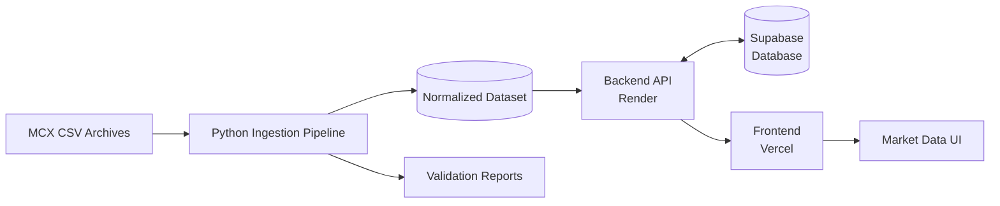
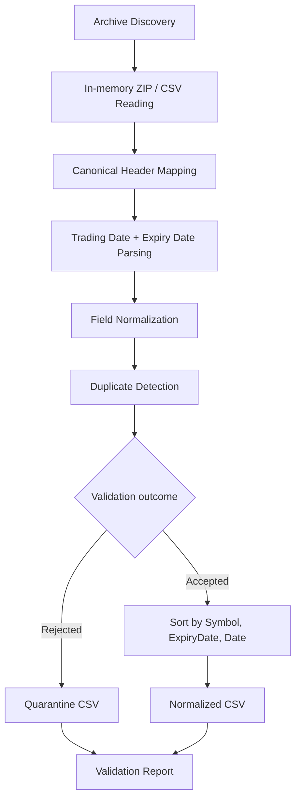
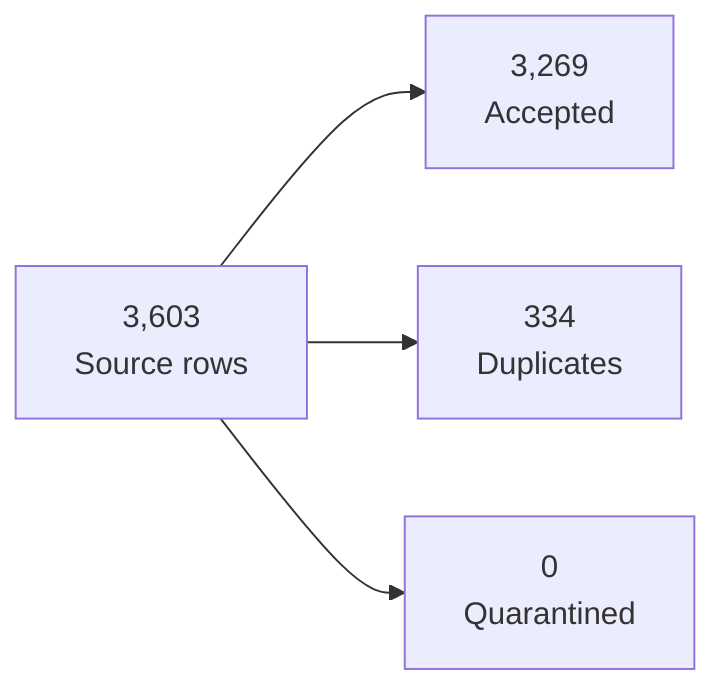
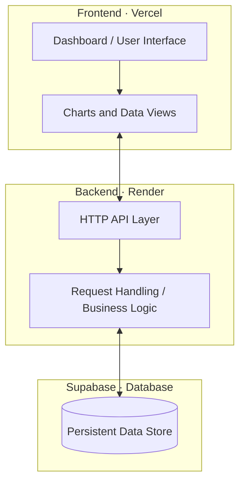

SwarnaNet
MCX Gold Derivatives Intelligence & Cross-Contract Analysis
Hack in Hills ’26 · Problem Statement 03

An expiry-aware data pipeline and web platform for exploring historical MCX gold-contract data.

Open Frontend · Backend URL

01 · Problem
MCX gold contracts differ in contract size, specifications, and expiry. Comparing historical records across raw files requires consistent schemas, reliable date parsing, duplicate handling, and traceable data-quality checks.
02 · Solution
SwarnaNet brings four contract categories into a common data workflow:

GOLDM · GOLDGUINEA · GOLDPETAL · GOLDTEN

The ingestion pipeline standardizes raw CSV records and preserves row-level expiry dates, creating a structured historical dataset for downstream application use.
System Architecture

Architecture overview: This is a high-level system view. Confirm each live connection in the current code and deployment configuration; deployment URLs alone do not prove database connectivity.
Data Pipeline

Pipeline engineering
- In-memory ingestion: Reads archive and CSV content using Python standard-library utilities without first extracting all source files to disk.
- Canonical schema mapping: Normalizes source headers into Symbol, Date, ExpiryDate, Open, High, Low, Close, Volume, and OpenInterest.
- Explicit field semantics: Uses Volume(Lots) for volume and Open Interest(Lots) for open interest; avoids confusing volume with Volume(In 000’s).
- Deterministic date normalization: Converts trading and expiry dates to ISO YYYY-MM-DD, retaining the expiry date recorded in each row rather than inferring it from a filename.
- Deduplication and reconciliation: Identifies duplicate/overlapping records and accounts for source rows as accepted, duplicate, or quarantined.
- Expiry-aware ordering: Sorts records by Symbol, ExpiryDate, and Date.
- Auditability: Produces a normalized dataset, quarantine log, and Markdown validation/audit reports.
Data Quality Snapshot
The latest figures previously reported for the ingestion run are shown below; rerun the pipeline and tests to reconfirm them against the current checkout.
Measure	Reported result
Raw CSV files	43
Source rows	3,603
Accepted normalized rows	3,269
Duplicate rows removed	334
Quarantined rows	0
Ingestion tests	7 passed

Reconciliation: 3,603 = 3,269 + 334 + 0

This demonstrates row-count accounting for that run; it does not alone prove that every market observation is economically correct.
Accepted records by contract
Contract	Accepted rows
GOLDM	612
GOLDGUINEA	879
GOLDPETAL	901
GOLDTEN	877

Frontend · Backend · Database

- Frontend — Vercel: User-facing web application for presenting contract data and analysis.
- Backend — Render: Hosted backend endpoint intended to provide application/API functionality. Verify health and API routes before claiming operational status.
- Database — Supabase: Database integration should be confirmed in current configuration. Document schema, authentication, row-level security (RLS), and data flow only after verifying them.
A deployed URL is not proof that the frontend is connected to the backend or that the backend is connected to Supabase. Validate these integrations before final submission.

Contract Universe
Symbol	Contract category
GOLDM	Gold Mini
GOLDGUINEA	Gold Guinea
GOLDPETAL	Gold Petal
GOLDTEN	Gold Ten

Refer to official MCX contract specifications for contract size, quotation convention, purity, and expiry rules before using these values in quantitative comparisons.
Technology
Component	Role
Python standard library	Archive and CSV ingestion, date parsing, normalization
CSV	Canonical processed dataset and quarantine log
Pytest	Ingestion test suite
Vercel	Frontend deployment
Render	Backend deployment
Supabase	Database integration; verify current connection and schema

Run Locally
1. Get the project repository.
2. Install dependencies using the repository’s manifest files.
3. Configure required environment variables from the example configuration, if available.
4. Run the ingestion pipeline (previously reported command: python src/pipeline/ingest.py).
5. Run tests (previously reported command: pytest).
6. Start frontend and backend using their respective project instructions.
Expected artifacts previously reported:
- data/processed/mcx_gold_normalized.csv
- data/processed/quarantine.csv
- reports/ingestion_validation.md
- reports/dataset_audit.md
Confirm these paths exist in the current checkout before relying on them.
Responsible Use
SwarnaNet is a data-analysis tool, not a guarantee of arbitrage or profit. Contract sizes, purity, quotation units, expiry alignment, liquidity, transaction costs, and data quality all affect interpretation. Validate any signal independently before making financial decisions.

SwarnaNet · Hack in Hills ’26 · Problem Statement 03
</div
