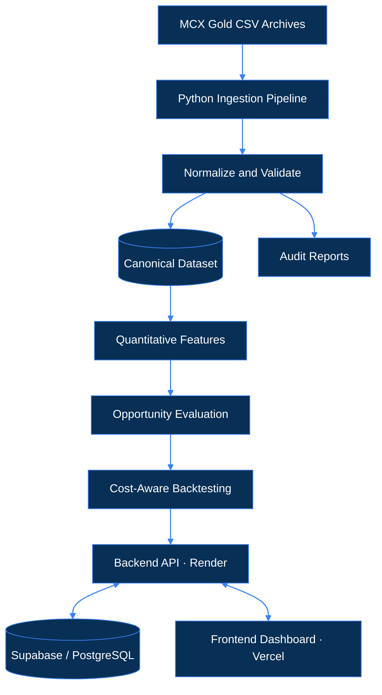
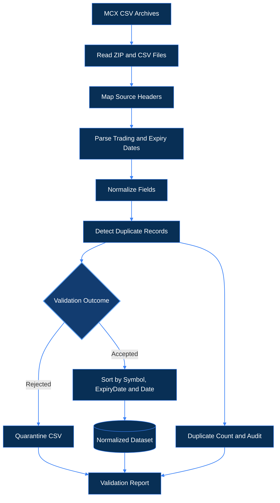
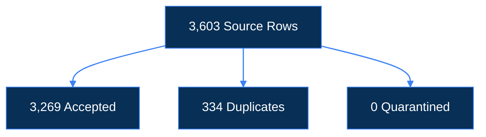

                                                                     
# SwarnaNet

### MCX Gold Derivatives Intelligence & Cross-Contract Analysis

**Hack in Hills ’26 · Problem Statement 03**

SwarnaNet is a project for exploring historical MCX gold-contract data and checking whether differences between contracts might represent a useful relative-value opportunity. The pipeline brings raw CSV files into a consistent format, while the analysis and backtesting account for contract specifications and estimated trading costs.

**[Open Frontend](https://swarna-net.vercel.app/) · [Backend API](https://swarnanet.onrender.com/)**

## The Problem

MCX gold contracts can differ in size, purity, quotation units, and expiry. Comparing their raw prices without accounting for these differences can lead to misleading conclusions. Even a real price gap may not be worth trading once brokerage, taxes, exchange charges, and slippage are considered.

## What's Included

- Historical CSV ingestion and schema normalization.
- Trading-date and contract-expiry parsing, preserving expiry dates from each source row.
- Duplicate detection and data-quality reports.
- A normalized dataset for downstream analysis.
- Cross-contract opportunity analysis and historical backtesting using the implemented strategy.
- A web interface for viewing available data and analytical results.

## System Architecture



*The diagram illustrates the intended architecture. Verify the actual backend and database connections before claiming they are operational.*-level view of the application flow. The deployed URLs are listed above; actual API and database connectivity should be checked against the current deployment and configuration.


## How the Data Pipeline Works

The pipeline converts raw MCX CSV archives into a structured dataset for quantitative analysis. It also records duplicate handling and validation results.



### Pipeline Highlights

- **In-memory processing:** Reads ZIP archives and CSV files without extracting all source files first.
- **Canonical schema:** Standardizes source columns into nine fields, including OHLC prices, volume, and open interest.
- **Expiry awareness:** Preserves the expiry date recorded in each source row.
- **Duplicate handling:** Removes duplicate records and accounts for them in the validation results.
- **Traceable outputs:** Generates the normalized dataset, quarantine log, and audit reports.


## Dataset Audit

The following figures were reported in a previous ingestion run. Rerun the pipeline and review the reports to confirm them against the current dataset.

| Metric | Reported Result |
|---|---:|
| Source CSV files | 43 |
| Raw source rows | 3,603 |
| Accepted normalized rows | 3,269 |
| Duplicate rows removed | 334 |
| Quarantined rows | 0 |
| Ingestion tests passed | 7 |

### Row Reconciliation



**Reconciliation:** `3,603 = 3,269 + 334 + 0`

### Accepted Records by Contract

| Contract | Accepted Rows |
|---|---:|
| GOLDM | 612 |
| GOLDGUINEA | 879 |
| GOLDPETAL | 901 |
| GOLDTEN | 877 |

These figures describe the previously reported run. They should not replace a review of the source data or individual data-quality exceptions.

## Backtesting Snapshot

The following results were reported in an earlier backtest and have not been independently revalidated here.

| Metric | Reported Result |
|---|---:|
| Trades | 42 |
| Gross PnL | ₹5,031.00 |
| Estimated transaction costs | ₹15,411.76 |
| **Net PnL** | **−₹10,380.76** |
| Net Sharpe ratio | −1.7888 |
| Out-of-sample net PnL | −₹5,840.35 |
| Out-of-sample Sharpe ratio | −3.5024 |

### What the Results Show

In the reported run, estimated transaction costs exceeded gross PnL, leaving the strategy with a net loss.

This is an important result to keep visible: identifying a price difference is not the same as proving that a trade is profitable. Results depend on the strategy rules, data quality, and cost assumptions.

## Supported Contracts

SwarnaNet covers four MCX gold-contract categories:

`GOLDM` · `GOLDGUINEA` · `GOLDPETAL` · `GOLDTEN`

Contract specifications and quotation conventions can vary by contract and date. Verify contract size, purity, quotation units, and expiry rules against the applicable official MCX specifications before relying on quantitative comparisons.


## Technology Stack

| Component | Technology |
|---|---|
| Ingestion and processing | Python |
| Processed data and reports | CSV, Markdown |
| Pipeline testing | pytest |
| Frontend | Next.js, React, TypeScript |
| Database integration | Supabase / PostgreSQL |
| Frontend hosting | Vercel |
| Backend hosting | Render |

*Technology roles should be confirmed against the current repository and deployment configuration.*


## Project File Structure

The project is organized around the frontend, source datasets, ingestion pipeline, processed outputs, and validation tests.

```text
SWARNANET/
├── frontend/                    # Web application
│   └── src/
│       ├── app/                 # Pages and routes
│       ├── components/          # Reusable interface components
│       ├── hooks/               # Shared React hooks
│       ├── lib/                 # Utilities and client setup
│       └── types/               # TypeScript types
│
├── dataset/                     # Source MCX data by contract
│   ├── GOLDM/
│   ├── GOLDGUINEA/
│   ├── GOLDPETAL/
│   └── GOLDTEN/
│
├── src/
│   └── pipeline/
│       └── ingest.py            # Ingestion and normalization
│
├── data/
│   └── processed/
│       ├── mcx_gold_normalized.csv
│       └── quarantine.csv
│
├── reports/
│   ├── ingestion_validation.md
│   └── dataset_audit.md
│
├── tests/
│   └── test_ingestion.py
│
├── .env.example                 # Example environment settings
└── README.md
```

*This structure is a guide to the main project areas and reported output files. Some paths may differ between local copies; use the current repository as the source of truth.*

## Running Locally

From the project root, install the dependencies using the project's setup files. Then run the ingestion pipeline and tests:

```bash
python src/pipeline/ingest.py
python -m pytest
```

Configure local environment variables using the provided example configuration, if available. Never commit real credentials or secret keys.

Confirm that the commands, dependencies, and paths match your current checkout before running them.

### Expected Pipeline Outputs

The following files were reported as outputs of the ingestion workflow:

- `data/processed/mcx_gold_normalized.csv`
- `data/processed/quarantine.csv`
- `reports/ingestion_validation.md`
- `reports/dataset_audit.md`

## Future Work

There are several practical areas to improve next.

- **Complete the login system:** Add Supabase sign-up, login, logout, password reset, and session handling. Protect private pages and configure Row Level Security (RLS) policies before storing user-specific data.

- **Expand historical data:** Bring in more years of reliable MCX data and preserve source details with each import. If machine-learning models are introduced, train and evaluate them on the expanded dataset rather than assuming more rows will automatically improve results.

- **Strengthen the ingestion pipeline:** Support incremental imports, detect changed CSV headers, make reruns safe, and improve error logging and row-level reconciliation.

- **Improve data checks:** Flag missing prices, unusual volume or open-interest changes, and inconsistent records for review.

- **Improve strategy testing:** Review transaction fees and slippage assumptions, run sensitivity checks, and expand walk-forward and out-of-sample testing.

- **Polish the dashboard:** Show when data was last refreshed, provide useful exports, and make contract and expiry comparisons easier to inspect.

- **Add end-to-end testing:** Test the pipeline, API, database permissions, refresh process, and frontend together—not just as separate components.

These are planned improvements, not claims that the features are already complete.

## Responsible Use

SwarnaNet is a research and demonstration project, not a trading recommendation. Historical backtests do not predict future results, and the reported strategy results above were negative after estimated costs.

Any real trading decision requires independent checks of the data, contract specifications, liquidity, execution assumptions, and transaction costs.
