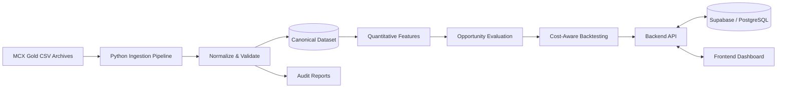
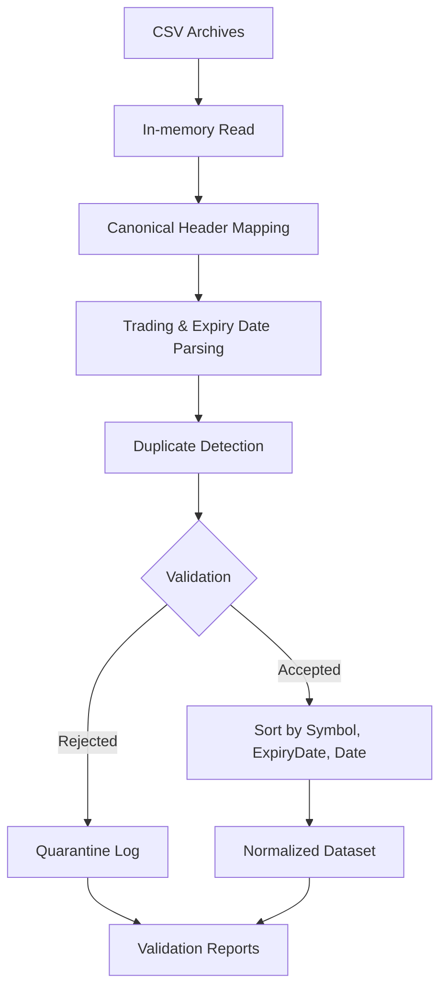
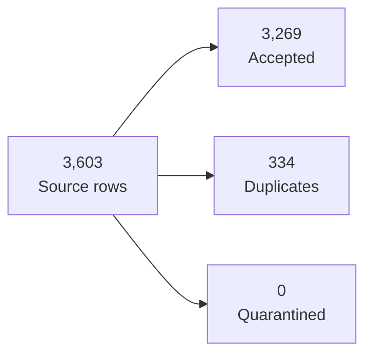

SwarnaNet
MCX Gold Derivatives Intelligence & Cross-Contract Relative Value
Hack in Hills ’26 · Problem Statement 03
A price difference is not an opportunity until the numbers survive the costs.

SwarnaNet is a quantitative research platform for analyzing historical MCX gold contracts, evaluating cross-contract relative-value signals, and testing strategies after estimated transaction costs.

Open Frontend · Backend API
The Challenge
MCX gold contracts differ in size, purity, quotation conventions, and expiry. Raw prices cannot be compared blindly: apparent discrepancies may reflect contract differences, and trading costs can erase a theoretical edge.
What SwarnaNet Does
- Expiry-aware ingestion — standardizes historical MCX CSV data while preserving each row’s recorded expiry.
- Data validation — maps source headers, parses dates, detects duplicates, and generates audit outputs.
- Cross-contract analysis — prepares structured observations for contract-aware comparisons and opportunity evaluation.
- Cost-aware backtesting — evaluates gross results against estimated transaction costs and net performance.
- Analytics dashboard — presents supported market-data and quantitative outputs.
System Architecture

Architecture overview; confirm live service and database connectivity in the current deployment configuration.
Data Pipeline

Pipeline Details
- Uses Python standard-library utilities for ZIP/CSV processing.
- Normalizes records to Symbol, Date, ExpiryDate, Open, High, Low, Close, Volume, and OpenInterest.
- Uses Volume(Lots) and Open Interest(Lots) for their respective fields; avoids confusing volume with Volume(In 000’s).
- Converts dates to ISO YYYY-MM-DD and preserves row-level expiry values instead of inferring expiry from filenames.
- Deduplicates overlapping records and sorts accepted observations by contract and date.
- Produces a normalized dataset, quarantine log, and validation/audit reports.
Dataset Audit
Previously reported ingestion run — rerun the pipeline to verify against the current checkout.
Metric	Reported result
Source CSV files	43
Raw source rows	3,603
Accepted normalized rows	3,269
Duplicate rows removed	334
Quarantined rows	0
Ingestion tests	7 passed

Reconciliation: 3,603 = 3,269 + 334 + 0
Contract	Accepted rows
GOLDM	612
GOLDGUINEA	879
GOLDPETAL	901
GOLDTEN	877

Backtesting: Costs Matter
Previously reported results; not independently revalidated in this README.
Metric	Reported result
Trades	42
Gross PnL	₹5,031.00
Estimated transaction costs	₹15,411.76
Net PnL	−₹10,380.76
Net Sharpe ratio	−1.7888
Out-of-sample net PnL	−₹5,840.35
Out-of-sample Sharpe ratio	−3.5024

The reported strategy was friction-constrained: estimated transaction costs exceeded gross profit, producing negative net PnL. This is a useful validation result—not evidence of profitability. It highlights why a price discrepancy must be assessed against costs and assumptions before being treated as an opportunity.
Supported Contracts
GOLDM · GOLDGUINEA · GOLDPETAL · GOLDTEN

Contract specifications, quotation units, purity, and expiry rules should be verified against official MCX specifications before quantitative comparisons.
Technology
Layer	Technologies
Data pipeline & quantitative processing	Python
Dataset & audit outputs	CSV, Markdown
Testing	pytest
Frontend	Next.js, React, TypeScript
Database integration	Supabase / PostgreSQL
Hosting	Vercel (frontend), Render (backend)

Technology and service roles should be checked against the current repository and deployment configuration.
Run Locally
1. Install dependencies using the project’s manifests and setup instructions.
2. Configure required environment variables using the provided example file, if available. Never commit secrets.
3. Run the ingestion pipeline:
   python src/pipeline/ingest.py
4. Run tests:
   python -m pytest
Previously reported outputs:
- data/processed/mcx_gold_normalized.csv
- data/processed/quarantine.csv
- reports/ingestion_validation.md
- reports/dataset_audit.md
Confirm these paths and commands against the current checkout.
Responsible Use
SwarnaNet is an educational and quantitative research prototype—not a guarantee of arbitrage or profit, and not financial advice. Historical results do not predict future performance. Data quality, contract specifications, liquidity, slippage, transaction costs, and execution assumptions can materially change outcomes.
SwarnaNet · Analyze the relationship. Validate the opportunity. Respect the costs.
