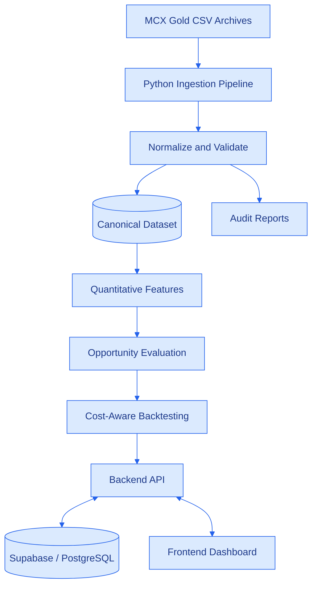
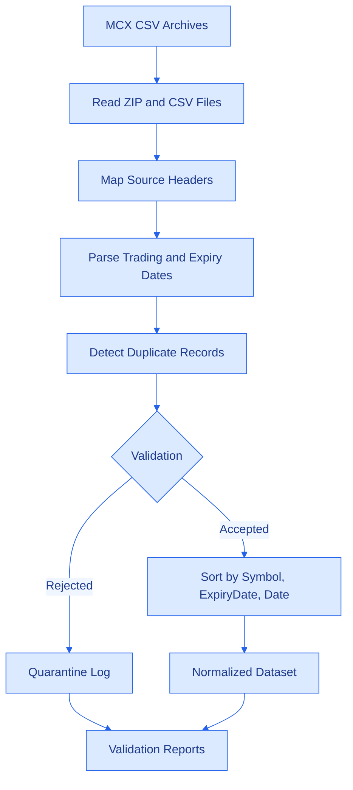
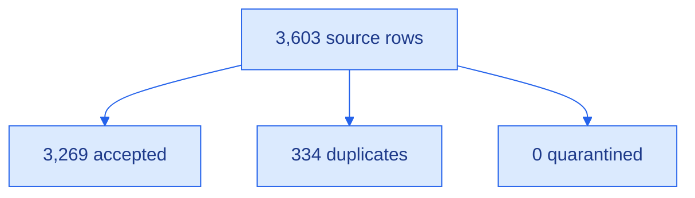

                                                                     SwarnaNet

MCX Gold Derivatives Intelligence & Cross-Contract Analysis
Hack in Hills ’26 · Problem Statement 03

SwarnaNet is a project for exploring historical MCX gold-contract data and checking whether differences between contracts might represent a useful relative-value opportunity. The pipeline brings raw CSV files into a consistent format, while the analysis and backtesting work considers contract specifications and estimated trading costs.

Open Frontend · Backend URL
The problem
MCX gold contracts can differ in size, purity, quotation units, and expiry. Comparing their raw prices without accounting for those differences can lead to misleading conclusions. Even a real price gap may not be worth trading once brokerage, taxes, exchange charges, and slippage are considered.

SwarnaNet is being built to make these comparisons more structured and easier to check.
What’s included
- Historical CSV ingestion and schema normalization.
- Trading-date and contract-expiry parsing, with expiry kept from each source row.
- Duplicate detection and data-quality reports.
- A normalized dataset for downstream analysis.
- Cross-contract opportunity analysis and historical backtesting, based on the implemented strategy.
- A web interface for viewing available data and analytical results.
System architecture

This is a high-level view of the application flow. The deployed URLs are listed above; actual API and database connectivity should be checked against the current deployment and configuration.
How the data pipeline works

The ingestion code uses Python standard-library utilities to read archive and CSV content in memory. It maps source fields to a nine-column schema:

Symbol, Date, ExpiryDate, Open, High, Low, Close, Volume, OpenInterest

A couple of details matter here:
- Volume is read from Volume(Lots), and OpenInterest from Open Interest(Lots). The similarly named Volume(In 000’s) field is not used for volume.
- Trading and expiry dates are converted to ISO YYYY-MM-DD format. The expiry recorded in each row is kept; it is not guessed from a filename.
- Accepted records are sorted by symbol, expiry date, and trading date. Duplicate records are accounted for separately from accepted and quarantined rows.
Dataset audit
The following figures were reported for a previous ingestion run. Run the pipeline and inspect the reports to confirm them if the source files or code have changed.
Measure	Reported result
Source CSV files	43
Raw source rows	3,603
Accepted normalized rows	3,269
Duplicate rows removed	334
Quarantined rows	0
Ingestion tests	7 passed

Row reconciliation: 3,603 = 3,269 + 334 + 0.

Accepted records by contract:
Contract	Accepted rows
GOLDM	612
GOLDGUINEA	879
GOLDPETAL	901
GOLDTEN	877

These counts describe the reported run; they are not a substitute for checking the source data or reviewing individual data-quality exceptions.
Backtesting snapshot
These results were also reported from an earlier run and have not been independently revalidated here.
Metric	Reported result
Trades	42
Gross PnL	₹5,031.00
Estimated transaction costs	₹15,411.76
Net PnL	−₹10,380.76
Net Sharpe ratio	−1.7888
Out-of-sample net PnL	−₹5,840.35
Out-of-sample Sharpe ratio	−3.5024

In this run, estimated transaction costs were higher than gross PnL, so the strategy ended with a loss after costs. That is an important result to keep visible: finding a price difference is not the same as proving a trade is profitable. Results depend on the strategy rules, data quality, and cost assumptions.
Contracts covered
GOLDM · GOLDGUINEA · GOLDPETAL · GOLDTEN

Contract specifications and quotation conventions can vary by contract and date. Verify size, purity, units, and expiry rules against the applicable official MCX specifications before relying on a comparison.
Technology
Part	Technology
Ingestion and processing	Python
Processed data and reports	CSV, Markdown
Pipeline tests	pytest
Frontend	Next.js, React, TypeScript
Database integration	Supabase / PostgreSQL
Hosting	Vercel for the frontend; Render for the backend

Check the repository configuration for exact dependencies and versions.
Project file structure
SWARNANET/
├── frontend/                         # Web application
│   └── src/
│       ├── app/                      # Pages and routes
│       ├── components/               # Reusable interface components
│       ├── hooks/                    # Shared React hooks
│       ├── lib/                      # Utilities and client setup
│       └── types/                    # TypeScript types
├── dataset/                          # Source MCX data, grouped by contract
│   ├── GOLDM/
│   ├── GOLDGUINEA/
│   ├── GOLDPETAL/
│   └── GOLDTEN/
├── src/
│   └── pipeline/
│       └── ingest.py                 # Ingestion and normalization
├── data/
│   └── processed/
│       ├── mcx_gold_normalized.csv
│       └── quarantine.csv
├── reports/
│   ├── ingestion_validation.md
│   └── dataset_audit.md
├── tests/
│   └── test_ingestion.py
├── .env.example                      # Example environment settings, if present
└── README.md
This is a guide to the main project areas and reported output files. Folder names can differ between local copies, so use the current repository as the source of truth.
Run locally
From the project root, install dependencies using the project’s setup files, then run the pipeline and tests:
python src/pipeline/ingest.py
python -m pytest
These commands were used in the reported ingestion workflow. Confirm that the paths and required dependencies match your current checkout. Set local environment variables from the provided example configuration, if available, and do not commit real credentials.

Expected pipeline outputs from the reported run:
- data/processed/mcx_gold_normalized.csv
- data/processed/quarantine.csv
- reports/ingestion_validation.md
- reports/dataset_audit.md
Future work
There are several practical areas to improve next:
- Finish the login system: Add Supabase sign-up, login, logout, password reset, and session handling. Protect private pages and configure Row Level Security policies before storing user-specific data.
- Add more market history: Bring in more years of reliable MCX data and keep source details with each import. If machine-learning models are added or used in the analysis, retrain and evaluate them on the expanded data rather than assuming more rows automatically improve results.
- Make ingestion more robust: Support incremental imports, detect changed CSV headers, make reruns safe, and add clearer error logs and row-level reconciliation.
- Improve data checks: Flag missing prices, unusual volume or open-interest changes, and inconsistent records for review.
- Test strategy assumptions more thoroughly: Review transaction fees and slippage, run sensitivity checks, and expand walk-forward and out-of-sample testing.
- Polish the dashboard: Show when data was last refreshed, provide useful exports, and make contract and expiry comparisons easier to inspect.
- Add end-to-end checks: Test the pipeline, API, database permissions, refresh process, and frontend together—not just as separate parts.
These are planned improvements, not statements that the features are already complete.
Note on use
SwarnaNet is a research and demonstration project, not a trading recommendation. Historical backtests do not predict future results, and the reported strategy results above were negative after estimated costs. Any real trading decision would need independent checks of the data, contract terms, liquidity, execution assumptions, and costs.
